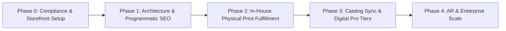

# 🚀 PrintForge Studio: Master Project Blueprint & Execution Plan

**Author:** Antigravity Project Manager (incorporating Technical & SEO Architect + Legal & Operations Strategist)  
**Project:** [PrintForge Studio](https://gabrielkhenrique.github.io/printforge-studio/)  
**Target:** Scaling from single-file WebGL prototype to a high-traffic, cash-generating 3D printing software and physical manufacturing business.

---

## 1. Executive Roadmap Overview



| Phase | Core Objective | Primary Deliverables | Target Timeline | Revenue Stream |
| :--- | :--- | :--- | :--- | :--- |
| **Phase 0** | **Compliance & Safety** | Legal guardrails, CC-NC check, Pirate Ship & packaging procurement | Weeks 1 – 2 | Affiliate links live |
| **Phase 1** | **Tech Modernization & SEO** | Astro + Three.js islands, Cloudflare Pages, 30 programmatic device pages (`/stand/[slug]`) | Weeks 3 – 4 | Organic traffic capture |
| **Phase 2** | **Physical Print Engine** | Stripe Checkout integration, automated Discord print queue, Bambu Lab in-house production | Weeks 5 – 8 | **$18.99 physical sales ($10.35 net profit/unit)** |
| **Phase 3** | **Digital Pro & Catalog Sync** | $2.99/mo Pro / $10 token packs, headless Thingiverse/Printables edge sync, STEP exports | Weeks 9 – 14 | **Digital MRR + Physical Scale** |
| **Phase 4** | **AR & Ecosystem Scale** | Mobile WebXR AR preview, native Bambu `.3mf` export, B2B custom corporate orders | Months 5+ | High-volume B2B & POD |

---

## 2. Phase 0: Legal Compliance, IP Guardrails & Procurement (Weeks 1 – 2)

> [!CAUTION]
> **Urgent Legal Boundary (Creative Commons Non-Commercial):**  
> Many third-party designs on Thingiverse and Printables carry **CC BY-NC (Non-Commercial)** licenses. Selling physical 3D prints of CC-NC designs without explicit designer licensing is copyright infringement.

### 2.1 The Two-Tier Catalog Architecture
1. **Native Parametric Studio Models (100% Legal & Safe to Sell):**
   - Procedurally generated in code by PrintForge Studio's CAD engine.
   - Pure functional utility articles under US Copyright Law (*Star Athletica v. Varsity Brands*).
   - **Full commercial authorization:** You can sell unlimited physical prints ($18.99 – $24.99) with zero legal exposure.
2. **Third-Party Curated Library (Thingiverse / Printables):**
   - **TASL Attribution:** Every model card displays Title, Author, Source, and License links.
   - **Commercial Guardrail:** Models with CC-NC or Standard Digital File licenses have the physical purchase button disabled and replaced with: `🔒 Non-Commercial License (Personal 3D Print STL Only)`.
   - Physical manufacturing is enabled **only** for verified CC0, CC-BY, or Native Parametric designs.

### 2.2 Physical Packaging & Fulfillment Procurement
Before accepting live physical orders, procure the following starter inventory:
* **Corrugated Mailer Boxes (100 units):** 7" x 5" x 3" die-cut roll-end tuck-top boxes (~$0.70/box from EcoEnclose or Uline). Avoid poly mailers; sorting machines crush cantilevered stand tabs.
* **Honeycomb Kraft Cushioning Wrap:** 100% biodegradable paper wrap replacing plastic bubble wrap.
* **Thermal Label Printer:** Munbyn or Rollo 4" x 6" thermal printer for inkless, waterproof USPS labels.
* **Discount Postage Account:** Set up **Pirate Ship** (commercial base pricing: $3.99 – $4.44 per 8 oz package via USPS Ground Advantage, includes $100 insurance).
* **Thermal Care Insert Card:** 4" x 6" branded insert explaining PLA care (do not leave in hot cars >55°C / 130°F) and warranty remake policy.

---

## 3. Phase 1: Technical Modernization & Programmatic SEO (Weeks 3 – 4)

### 3.1 Architecture: Astro + Client Islands on Cloudflare Pages
* **Framework:** Migrate from single-file `index.html` to **Astro** with isolated client islands (Svelte 5 or React) for the Three.js viewport and AI Copilot.
* **Hosting:** Deploy on **Cloudflare Pages** (apex domain `printforgestudio.com` with CNAME flattening).
  * **Zero bandwidth egress fees** (critical when serving multi-megabyte 3D files).
  * Global TTFB < 30ms.

### 3.2 Programmatic SEO Landing Pages
Pre-render 30 high-intent static device pages at build time:
* `/stand/nintendo-switch-2`
* `/stand/ps5-dualsense`
* `/stand/steam-deck-oled`
* `/stand/rog-ally-x`
* `/stand/iphone-16-pro-magsafe`

#### Structured Data (Google 3D Rich Snippets):
Every programmatic page embeds unified JSON-LD metadata combining `schema.org/Product` + `3DModel` + `BreadcrumbList` + `FAQPage`, allowing Google to display **"View in 3D"** and AR placement badges in mobile search results.

---

## 4. Phase 2: In-House Physical Print Fulfillment Engine (Weeks 5 – 8)

### 4.1 Unit Economics & Profit Margins (Based on Your 3D Printer)

| Cost Component | Calculation Basis | Unit Cost |
| :--- | :--- | :--- |
| **Raw Filament (PLA+/PETG)** | ~100g spool usage @ $18.00/kg | $1.80 |
| **Electricity** | 0.25 kWh @ $0.15/kWh | $0.04 |
| **Nozzle / PEI Bed Amortization**| Hardware replacement reserve | $0.25 |
| **Machine Depreciation** | $600 printer / 1,500 prints | $0.40 |
| **Packaging & Collateral** | Rigid Box + Honeycomb Wrap + Label + Card | $1.15 |
| **USPS Ground Advantage (Commercial)**| 8 oz national shipping via Pirate Ship | $4.15 |
| **Stripe Processing Fee** | 2.9% + $0.30 on $18.99 | $0.85 |
| **Total Cost of Goods Sold (COGS)**| All manufacturing & delivery expenses | **$8.64** |
| **Retail Sale Price** | Standard Tier (Free Shipping) | **$18.99** |
| **Net Creator Profit per Stand** | Retail Price - COGS | **$10.35 (54.5% Net Margin)** |

### 4.2 Automated Order Pipeline
```
[Customer Checkout on Stripe] 
            │
            ▼ (Stripe Webhook)
[Discord / Telegram Alert on Your Phone]
  "🚨 New Order: PS5 Stand (Matte Charcoal) - Payout: $18.99 - [Download .3MF]"
            │
            ▼
[Print on Your 3D Printer (2h 15m)]
            │
            ▼
[5-Point QA Audit: Slot measurement, deburr, base wobble test]
            │
            ▼
[Pirate Ship 1-Click Label Print] ➔ [Free USPS Front Door Pickup]
```

---

## 5. Phase 3: External Catalog Edge Sync & Digital Pro Tiers (Weeks 9 – 14)

### 5.1 Headless API Sync (Thingiverse & Printables)
* **Problem:** Direct browser calls hit Thingiverse's 300 req/5 min limit and Printables Cloudflare bot protection.
* **Solution:** Scheduled Cloudflare Cron Worker runs every 12 hours with server-side secrets. Fetches trending models, normalizes data, and caches models in Cloudflare D1 / KV with a 24-hour Stale-While-Revalidate edge proxy (`/api/search`).
* **Parametric Archetypes:** Automatically maps external catalog items to verified editable CAD baselines (Controllers, Handhelds, Phones, Tablets, Tools).

### 5.2 Digital Software Monetization (Stripe Billing)
* **$2.99 / Month Pro Subscription (or $10 Credit Pack):**
  * Eliminates microtransaction fee drag (avoids Stripe's $0.30 fixed fee per $2.00 charge).
  * Unlimited AI Copilot natural language parameter generation.
  * **Commercial Merchant License:** Authorizes users to sell physical prints made from PrintForge designs on Etsy/Shopify.
  * **STEP (.stp) Solid CAD Export:** Clean B-Rep CAD geometry for Fusion 360, SolidWorks, and Onshape (bypassing faceted mesh limitations).

---

## 6. Phase 4: AR, Slicer Ecosystem & Enterprise Scale (Months 5+)

1. **Mobile WebXR / Google Scene Viewer:** Visitors on iOS and Android tap *"View in AR"* to place the custom 3D stand on their real physical desk before printing.
2. **Native Bambu `.3mf` Export:** Exports pre-sliced `.3mf` files with embedded 0.20mm Standard settings, 3 walls, and gyroid infill for instant drag-and-drop printing into Bambu Studio and OrcaSlicer.
3. **Backup Print-On-Demand (POD) Spillover:** Integrate **Slant 3D REST API** to automatically route print overflow if your daily queue exceeds your printer capacity (15+ orders/day).
4. **B2B Corporate Desk Swag:** Custom branded bulk runs (50–200 units with embossed company/esports logos for $12–$15/unit).

---

## 7. Immediate Action Checklist for Creator

- [ ] **Procurement:** Set up a free account on **Pirate Ship** (`pirateship.com`) to access commercial postal rates.
- [ ] **Packaging:** Order sample pack of 7"x5"x3" corrugated mailer boxes.
- [ ] **Stripe Activation:** Create and verify your Stripe account to receive automated bank deposits from sales.
- [ ] **Code Guardrail:** Implement the CC-NC license check in the web interface so physical print orders are restricted to native parametric and CC0/CC-BY models.
